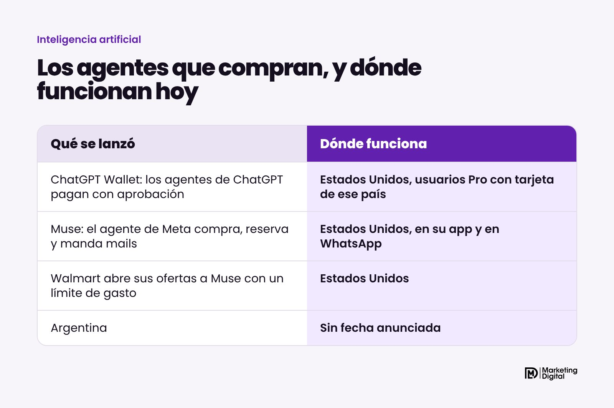
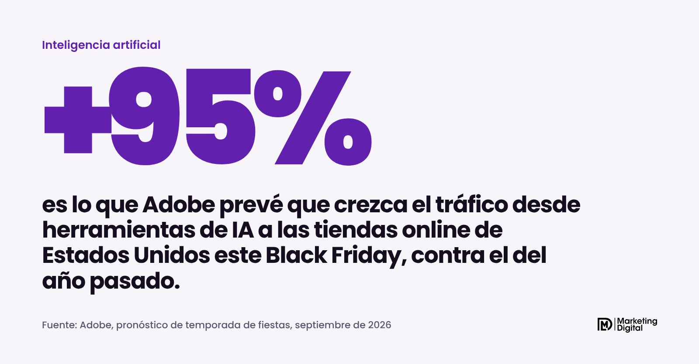
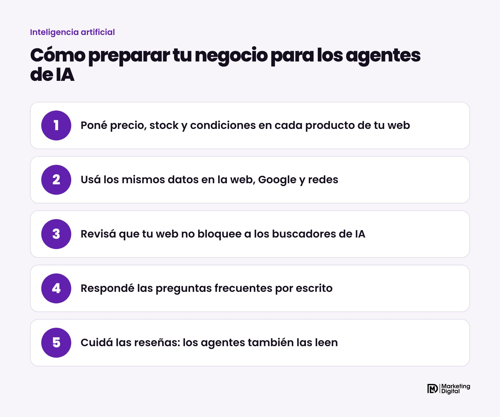

Sí, en este Black Friday ya hay agentes de inteligencia artificial que compran en nombre de las personas. OpenAI lanzó en noviembre ChatGPT Wallet para que sus agentes paguen compras, y Walmart abrió sus ofertas a Muse, el agente de Meta. Por ahora todo funciona solo en Estados Unidos, y pocas personas dejan que la IA termine la compra. Pero la tendencia es clara, y para una pyme argentina lo que conviene hacer ya es lo mismo que pide un cliente exigente: precios, stock y datos claros.

## ¿Qué es un agente de IA que compra?

Es un asistente que no solo responde preguntas, sino que hace tareas: busca productos, compara precios, arma el carrito y, si la persona lo aprueba, paga. La diferencia con un chatbot es que actúa en tu nombre.

Según Meta, hablar con Muse "funciona igual que escribirle a otra persona", en su app o directamente en WhatsApp. Puede reservar viajes, mandar mails y comprar, y siempre consulta antes de una acción sensible, como una compra. Meta da un ejemplo: convertir un reel de una receta guardado en Instagram en una lista del súper.

## ¿Qué se lanzó este mes?

Tres anuncios marcan el momento:

- **ChatGPT Wallet (13 de noviembre).** OpenAI permite que sus agentes paguen sin ver los datos reales de la tarjeta. Cada compra pide una verificación. Por ahora es para usuarios de ChatGPT Pro mayores de 18 años en Estados Unidos, con tarjetas emitidas allá.
- **Muse (desde septiembre).** El agente personal de Meta se está lanzando en Estados Unidos, en iOS, Android y la web.
- **Walmart y Muse (24 de noviembre).** Los clientes de Walmart pueden pasarle a Muse su lista de compras, y Walmart elige los productos. La primera vez, el cliente arma un perfil para el agente con un límite de gasto. Walmart lo resume así: "Tu lista. Tu Muse. Tus reglas".

Ninguna de las tres empresas menciona Argentina ni Latinoamérica, y no hay fechas para otros países.

## ¿La gente realmente deja que la IA compre?

Todavía poco. Según la encuesta de fiestas de Deloitte, hecha a 4.000 consumidores de Estados Unidos, el 39% usa IA generativa como herramienta principal para al menos una tarea de sus compras navideñas, pero solo el 16% dice que dejaría que la IA complete una compra.

Lo que sí crece rápido es la IA como punto de partida. Adobe prevé que el tráfico desde herramientas de IA a las tiendas online de Estados Unidos crezca 130% en toda la temporada de fiestas, y 95% solo en el Black Friday. En su encuesta, el 77% de quienes ya compraron con ayuda de IA dice sentirse más seguro de su compra.

> Hoy la IA recomienda dónde comprar. Mañana también va a comprar. En los dos casos, elige con los datos que encuentra.

## ¿Qué miran los agentes para elegir?

Según IBM, los agentes priorizan precio, reseñas y disponibilidad, por lo que los datos de los productos tienen que estar ordenados y actualizados. Un informe de IBM lo dice sin vueltas: la información incompleta, inconsistente o que no se puede verificar provoca rechazo tanto de compradores humanos como de las máquinas.

OpenAI es la única de las tres empresas que explica qué tiene que hacer un comercio para que sus agentes puedan comprarle. Pide reclamar el negocio en ChatGPT y cargar un catálogo con precios y stock actualizados, y revisar que la seguridad de la web no bloquee a sus agentes. Advierte que algunos sitios "pueden bloquear sin querer" las compras hechas con estas herramientas.

| Lo que mira un agente | Lo que tenés que tener en tu web |
| --- | --- |
| Precio | Precio visible en cada producto, no "consultar" |
| Disponibilidad | Stock real o aclarar si es a pedido |
| Condiciones | Envíos, zonas, plazos y devoluciones por escrito |
| Confianza | Reseñas, datos de contacto y datos coherentes en todos lados |

## ¿Qué puede hacer hoy una pyme argentina?

No hace falta esperar a que estas herramientas lleguen al país. Lo que preparás para los agentes también te sirve hoy con clientes y buscadores:

1. **Poné precio, stock y condiciones en cada producto.** Muchas pymes escriben "consultar precio" para generar conversación. Para un agente, un producto sin precio es un producto que no puede comparar.
2. **Usá los mismos datos en todos lados.** Nombre, teléfono, horarios y precios iguales en la web, en Google y en redes. Si no coinciden, la IA desconfía o se confunde.
3. **Revisá que tu web no bloquee a la IA.** Algunas configuraciones de seguridad cierran la puerta a los buscadores y agentes de IA sin que el dueño lo sepa. Pedile a quien maneja tu web que lo revise.
4. **Respondé las preguntas frecuentes por escrito.** Envíos, formas de pago, garantía. Son las mismas preguntas que la gente le hace a la IA, y que la IA busca en tu web.
5. **Cuidá las reseñas.** Pedí opiniones a tus clientes conformes. Los agentes las usan para decidir, igual que las personas.

Si ya reclamaste el perfil de tu negocio en ChatGPT, este es el paso siguiente: que lo que muestra coincida con lo que dice tu web.

## En resumen

Los agentes de IA que compran ya existen, aunque por ahora solo en Estados Unidos y con poca gente dispuesta a delegar el pago. Lo que no espera es el cambio de fondo: cada vez más compras empiezan en una conversación con una IA, y esa IA elige con los datos que encuentra. Tener precios, stock y condiciones claros en tu web es la mejor preparación. Si querés que revisemos juntos cómo te ven hoy ChatGPT y Google, escribinos.
