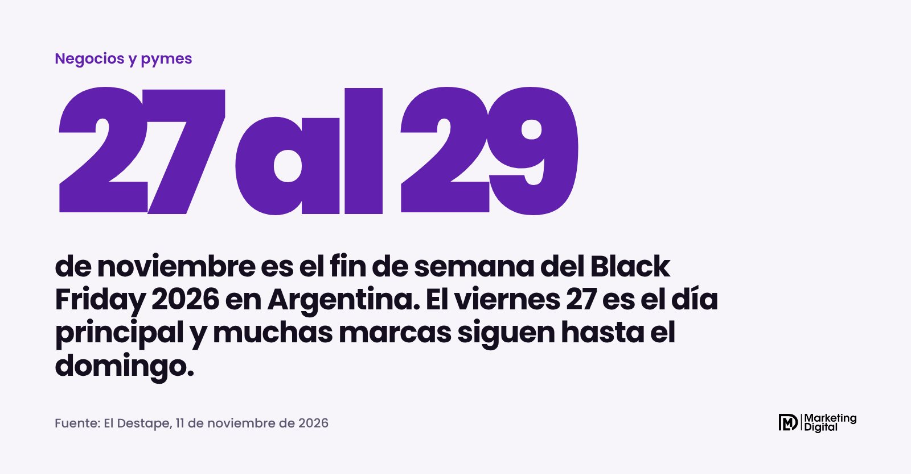
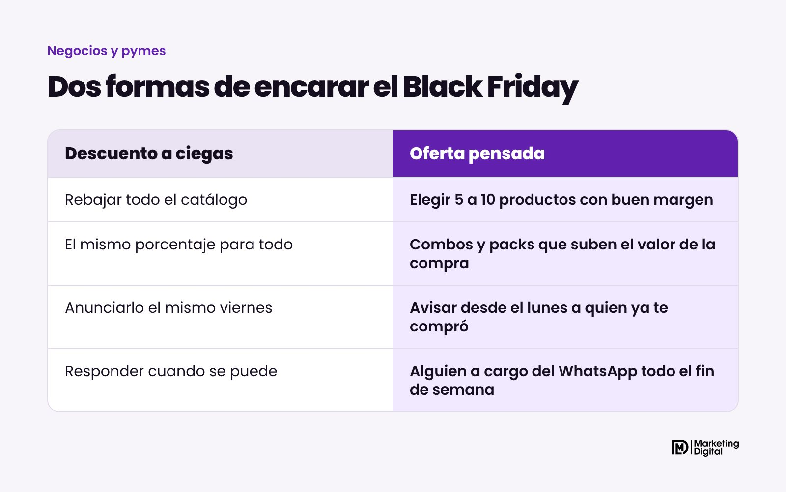
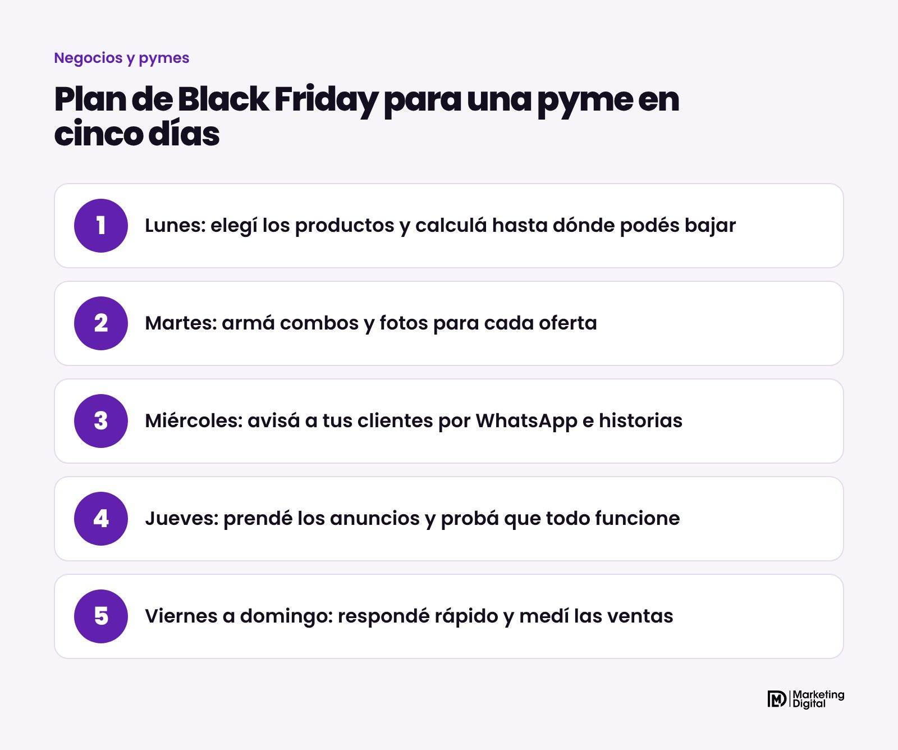

El Black Friday 2026 en Argentina es el viernes 27 de noviembre, y muchas marcas extienden las ofertas durante el sábado 28 y el domingo 29. A diferencia del CyberMonday, no tiene una cámara que lo organice ni una lista oficial de empresas: cualquier comercio puede sumarse, con sus propias reglas y en su propio canal. Para una pyme, eso es una oportunidad, siempre que la oferta esté pensada para vender más y no solo para bajar precios.

## ¿Cuándo es el Black Friday 2026?

Según El Destape, el día principal es el viernes 27 de noviembre, y las promociones pueden seguir todo el fin de semana, hasta el domingo 29. Algunas marcas lo estiran a una semana entera, lo que se conoce como Black Week.

La diferencia con otras fechas de descuentos es importante. El Hot Sale y el CyberMonday los organiza la Cámara Argentina de Comercio Electrónico (CACE), con empresas inscriptas y un sitio oficial. El Black Friday, según El Destape, "no tiene una entidad central que coordine las promociones en el país". No hay que anotarse en ningún lado ni pagar para participar.

## ¿Le conviene a una pyme sumarse?

Depende de cómo. El CyberMonday de hace tres semanas dejó una pista clara sobre cómo está comprando la gente. Según los datos de CACE:

| Indicador del CyberMonday 2026 | Contra 2025 |
| --- | --- |
| Productos vendidos | +20,7% |
| Órdenes de compra | -7,1% |
| Ticket promedio, en términos reales | -14,4% |
| Facturación, en términos reales | -20% |

La gente compró más productos, pero en menos compras y gastando menos en total. Aprovecha las fechas de ofertas para llevar varias cosas juntas, y compara mucho antes de decidir.

Del lado de los comercios, el ánimo es cauto. Según la última encuesta de CAME, el 54,9% de los comerciantes pyme cree que no es buen momento para invertir, y el 48,4% espera que su situación siga igual en los próximos doce meses. En ese contexto, un Black Friday mal planteado, con descuentos grandes en todo el catálogo, puede mover mercadería y dejar poca ganancia.

> El Black Friday no se gana con el descuento más grande. Se gana con la oferta que el cliente entiende en tres segundos.

## ¿Qué tipo de oferta funciona mejor?

Con un cliente que lleva más productos por compra, lo que mejor rinde es lo que facilita sumar:

- **Combos y packs.** "Llevá el kit completo", "comprá dos y el tercero con descuento", "el regalo armado". Subís el valor de cada venta sin bajar tanto el precio de cada producto.
- **Pocos productos, bien elegidos.** Entre 5 y 10, los que más rotan o los que mejor margen te dejan. Es más fácil comunicar pocas ofertas claras que un catálogo entero rebajado.
- **Un beneficio concreto.** Envío gratis desde cierto monto, un regalo con la compra o un precio especial para quien ya es cliente. A veces vale más que un porcentaje.
- **Un plazo real.** Si decís que termina el domingo, que termine el domingo. La credibilidad también es parte de la oferta.

Antes de publicar, hacé la cuenta: cuánto ganás con cada producto al precio de oferta. Si un combo te deja menos que una venta normal, no es una oferta, es una pérdida con buena cara.

## ¿Y si no tengo tienda online?

No hace falta. Muchas pymes venden por WhatsApp e Instagram, y para el Black Friday alcanza con eso si está bien organizado. Lo que importa es que el cliente vea la oferta, pregunte y reciba una respuesta rápida. En las campañas que manejamos lo vemos siempre: en las fechas de ofertas, una consulta que espera horas suele ser una venta que se va a otro comercio.

Tres cosas para tener listas antes del viernes:

1. **Un mensaje guardado por cada oferta**, con precio, condiciones y forma de pago, para responder en segundos.
2. **Alguien a cargo del WhatsApp** durante todo el fin de semana, con horarios claros.
3. **Un catálogo o historias destacadas** donde se vean todas las ofertas juntas.

## ¿Cómo organizarlo en una semana?

1. **Lunes: elegí y calculá.** Definí los productos y hasta dónde podés bajar sin perder plata.
2. **Martes: armá la oferta.** Combos, fotos de cada producto y un texto corto con precio y condiciones.
3. **Miércoles: avisá.** Primero a quienes ya te compraron, por WhatsApp. Después, en historias y publicaciones.
4. **Jueves: prendé los anuncios.** Si vas a invertir en publicidad, mejor arrancar un día antes. Los anuncios que abren un chat de WhatsApp funcionan bien para comercios que venden con asesoramiento. Probá que los links y los mensajes funcionen.
5. **Viernes a domingo: respondé y medí.** Anotá cuántas consultas llegan y cuántas terminan en venta. Te va a servir para las fiestas.

## En resumen

El Black Friday 2026 es del 27 al 29 de noviembre y no tiene organizador, así que cualquier pyme puede sumarse. Con un cliente que compara mucho y gasta menos por compra, lo que más rinde son las ofertas claras, los combos y la respuesta rápida, no el descuento más grande. Si querés que armemos juntos los anuncios para el fin de semana o para las fiestas, escribinos por WhatsApp.
