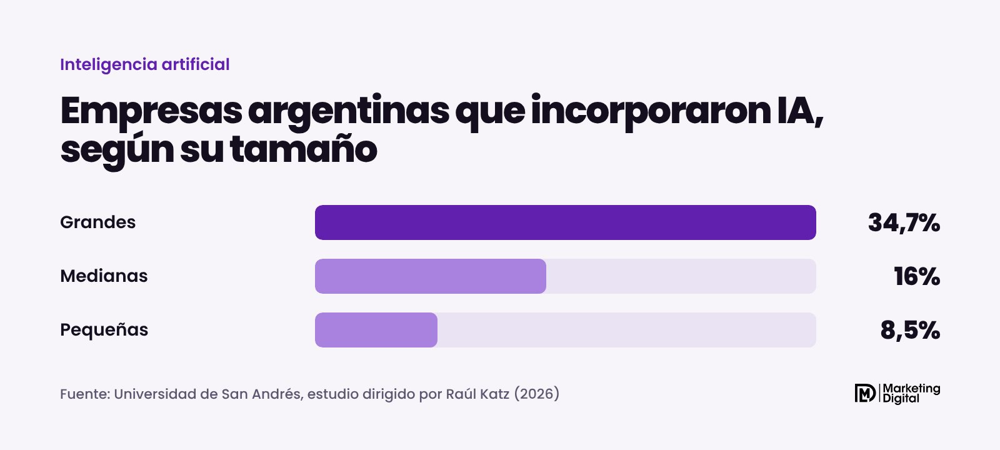
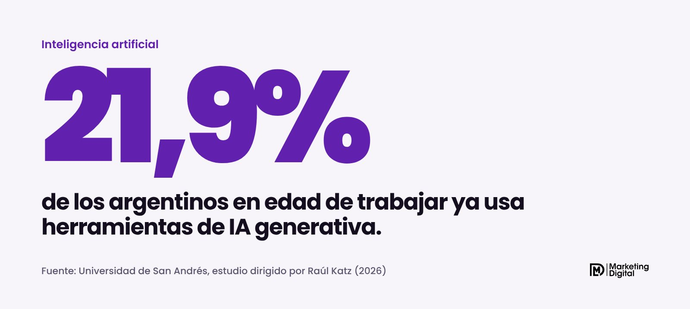
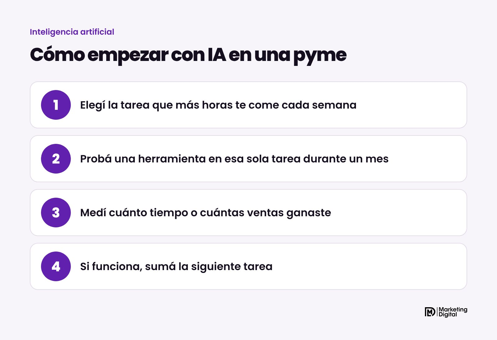

Pocas. Según un estudio de la Universidad de San Andrés difundido el 2 de noviembre de 2026, solo el 8,5% de las pequeñas empresas argentinas incorporó alguna aplicación de inteligencia artificial. En las medianas, el 16%. Mientras tanto, más de uno de cada cinco argentinos en edad de trabajar ya usa herramientas como ChatGPT o Gemini. Dicho de otra forma: tus clientes y tus empleados ya usan IA, pero la mayoría de las pymes todavía no la aplica en el negocio.

## ¿Qué dice el estudio?

El trabajo lo dirigió el economista Raúl Katz, con Luciana Pagani y Natalia Méndez Huergo, y se presentó en las Jornadas Internacionales de ATVC y CAPPSA. Mide cuánto se usa la IA en Argentina y cuánto podría aportar a la economía.

Los números de adopción en empresas son claros:

- **Grandes empresas:** el 34,7% incorporó alguna aplicación de IA. El promedio de los países de la OCDE es 54%.
- **Medianas:** 16%.
- **Pequeñas:** 8,5%.

En la región, Argentina tampoco va adelante. El estudio estima una adopción empresarial de 11,2%, detrás de Uruguay (16,5%), Chile (13,5%), Brasil (13%) y Colombia (12,7%).

## ¿Por qué la gente usa IA y las empresas no?

El estudio muestra que el 21,9% de los argentinos en edad laboral usa herramientas de IA generativa. Es muy probable que alguien de tu equipo ya le pida a ChatGPT que le arme un mail o le resuma un documento. El problema es que eso queda en lo personal: no cambia cómo vende, cómo atiende o cómo se organiza la empresa.

> Usar ChatGPT para un mail no es aplicar IA en el negocio. Aplicarla es cambiar cómo atendés, vendés o te organizás.

Otra encuesta, la de nadIA con el apoyo del BID y la Fundación Observatorio PyME, encontró algo parecido en empresas industriales y de software: el 41,6% usa al menos una tecnología de IA, pero la mayoría está en etapas tempranas. Probaron, pero todavía no la integraron.

## ¿Qué significa para tu pyme?

Que estás a tiempo. Cuando 9 de cada 10 pequeñas empresas todavía no usan IA, la que empieza ahora tiene ventaja sobre su competencia directa, no solo sobre las grandes.

Pensalo en términos concretos. Si un cliente te escribe un domingo a la noche por WhatsApp y nadie le contesta hasta el lunes, quizás le compra al que le contestó primero. Un agente de IA bien armado responde en el momento, con tus precios y tus horarios. En MDL lo vimos con Reyes del Colchón, que aumentó 40% sus ventas con un agente de IA.

No hace falta empezar por algo grande. Estas son las tareas donde una pyme suele notar el cambio más rápido:

| Tarea | Qué puede hacer la IA |
| --- | --- |
| Atención por WhatsApp | Responder preguntas frecuentes, pasar precios y tomar datos a cualquier hora |
| Contenido para redes | Proponer ideas, escribir textos y adaptar una pieza a varios formatos |
| Presupuestos y propuestas | Armar un borrador a partir de tus plantillas |
| Análisis de ventas | Ordenar planillas y mostrarte qué productos o meses rinden más |

## ¿Cómo empezar sin gastar de más?

1. **Elegí una sola tarea.** La que más horas te come por semana o la que más clientes te hace perder. Para muchas pymes es responder consultas.
2. **Probala un mes.** Con una herramienta y un objetivo claro: contestar más rápido, publicar más seguido, cerrar más presupuestos.
3. **Medí antes y después.** Tiempo de respuesta, consultas atendidas, ventas cerradas. Sin números no hay forma de saber si funcionó.
4. **Si rinde, sumá la siguiente.** Así la IA entra al negocio por resultados y no por moda.

Un cuidado importante: no cargues datos sensibles de tus clientes en herramientas gratuitas sin revisar sus condiciones de uso. Y que siempre haya una persona revisando lo que la IA responde, sobre todo al principio.

## ¿Cuánto está en juego?

El estudio calcula que, si Argentina acelera la adopción, la IA podría sumar a la economía unos US$17.700 millones por año hacia 2030, cerca del 2% del PBI. Si sigue al ritmo actual, unos US$12.700 millones. La diferencia entre los dos escenarios se juega, en buena parte, en las pymes que todavía no empezaron.

## En resumen

Los argentinos ya usan IA todos los días. Las pymes, en su mayoría, todavía no. Esa distancia es la oportunidad: la pequeña empresa que hoy aplica IA en una tarea concreta ya está delante de casi todo su rubro. Si querés saber por dónde empezar en tu negocio, escribinos y armamos juntos el primer paso.
