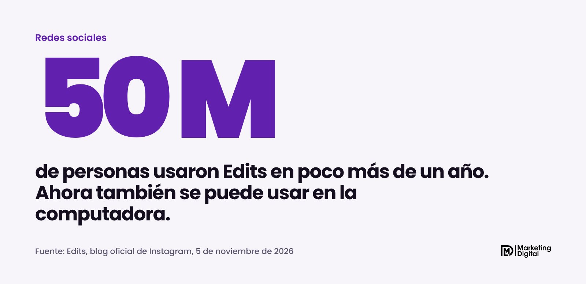
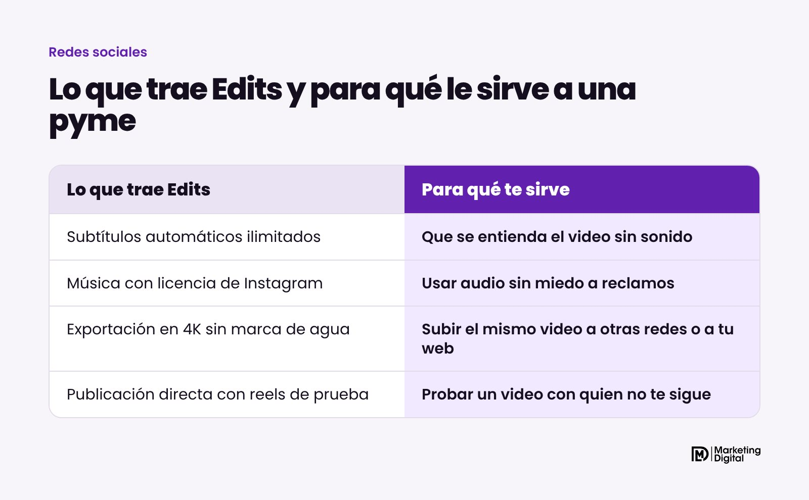
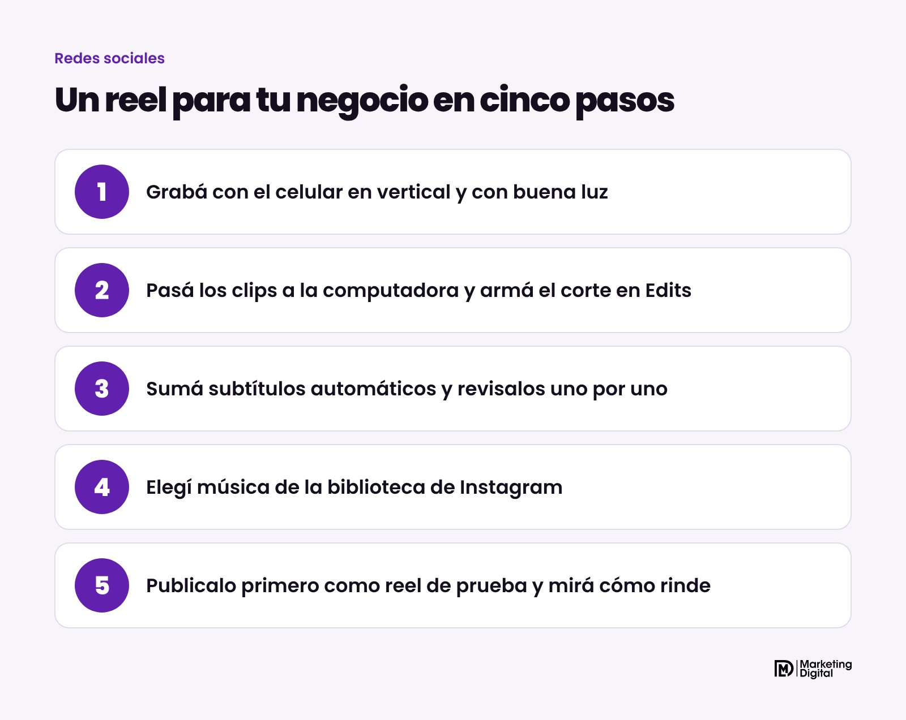

Sí, desde el 5 de noviembre de 2026 Edits, el editor de video gratis de Instagram, también funciona en la computadora. Por ahora está disponible solo para Mac. Para una pyme es una buena noticia: con una sola herramienta gratuita podés editar reels con subtítulos automáticos, usar música con licencia y exportar en 4K sin marca de agua, en una pantalla más cómoda que la del celular.

## ¿Qué es Edits?

Es la app de edición de video que Instagram lanzó a comienzos de 2025 para competir con CapCut. Según el blog oficial de Edits, ya la usaron 50 millones de personas en poco más de un año. Hasta ahora solo estaba en el celular.

La versión de computadora es gratuita y se descarga desde edits.com/desktop. El equipo de Edits dijo que la va a actualizar todas las semanas y que está trabajando para que un mismo proyecto se pueda editar en el celular y seguir en la computadora, algo que todavía no está disponible.

## ¿Qué trae la versión de computadora?

Las funciones que más le importan a una pyme son estas:

- **Línea de tiempo con varias pistas.** Podés poner video, música, voz y textos en capas, y cortar con precisión.
- **Subtítulos automáticos ilimitados**, en varios idiomas.
- **La biblioteca de música con licencia de Instagram**, más cientos de efectos de sonido y de video.
- **Formatos horizontales y verticales**, para el mismo video en reels, en YouTube o en tu web.
- **Exportación en 4K sin marca de agua.**
- **Publicación directa en Instagram**, con etiquetas, ubicación y reels de prueba.
- **Ajuste de color** con ruedas, curvas y la posibilidad de cargar tus propios filtros (LUT) y tipografías.

También permite guardar estilos de texto y de audio desde el celular y usarlos en la computadora. Si ya tenés una tipografía y unos colores de marca, quedan siempre iguales.

## ¿Por qué le sirve a una pyme?

Porque resuelve tres problemas comunes de quien hace sus propios videos.

**El primero es el sonido.** Mucha gente mira reels sin audio, en el trabajo o en el transporte. Sin subtítulos, el mensaje no llega. Edits los genera solos, y vos solo los corregís.

**El segundo es la música.** Usar una canción sin permiso puede hacer que te silencien el video. La biblioteca de Edits tiene audio con licencia para Instagram.

**El tercero es la prolijidad.** Editar un video de un minuto en la pantalla del celular es incómodo. En la computadora ves mejor los cortes, los textos y los colores, y el resultado se nota.

> Un reel no necesita producción de cine. Necesita que se entienda en los primeros segundos, con o sin sonido.

## ¿Y si uso Windows?

Por ahora Edits de escritorio es solo para Mac. Instagram no dio fecha para Windows. Mientras tanto, la app del celular sigue siendo gratis.

| Si tenés | Qué te conviene |
| --- | --- |
| Mac | Probar la versión de escritorio para editar con más comodidad |
| Windows | Seguir con la app del celular hasta que llegue la versión de escritorio |
| Solo celular | Usar la app de Edits, que también es gratis |

## ¿Cómo hacer un reel para tu negocio con Edits?

1. **Grabá en vertical y con buena luz.** La luz natural de una ventana alcanza. Lo importante es que se vea bien tu producto o tu trabajo.
2. **Armá el corte en la computadora.** Arrancá con lo más interesante: el resultado final, el antes y el después, la pregunta que te hacen siempre.
3. **Sumá subtítulos automáticos y revisalos.** La herramienta se equivoca con nombres propios y palabras técnicas.
4. **Elegí música de la biblioteca de Instagram.** Que acompañe, que no tape la voz.
5. **Publicalo como reel de prueba.** Así lo ven primero personas que no te siguen, y si rinde bien lo compartís con tus seguidores.

Un consejo extra: grabá varios clips en una misma jornada. Con un par de horas de grabación podés tener material para las publicaciones de todo el mes.

## En resumen

Edits en la computadora le saca una excusa a cualquier pyme para no publicar videos: es gratis, trae subtítulos, música con licencia y exporta sin marca de agua. Lo que sigue haciendo la diferencia es qué mostrás y cómo lo contás. Si querés que armemos juntos un plan de reels para tu negocio, escribinos.
