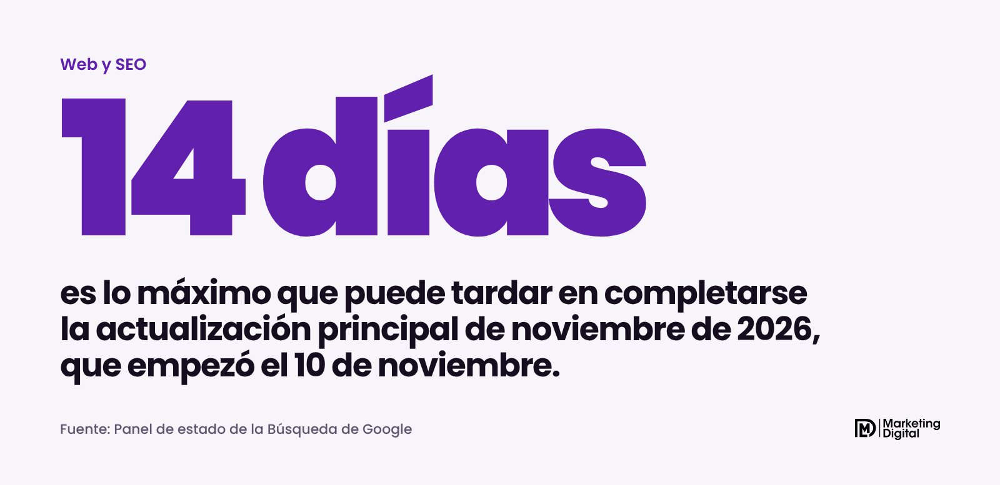
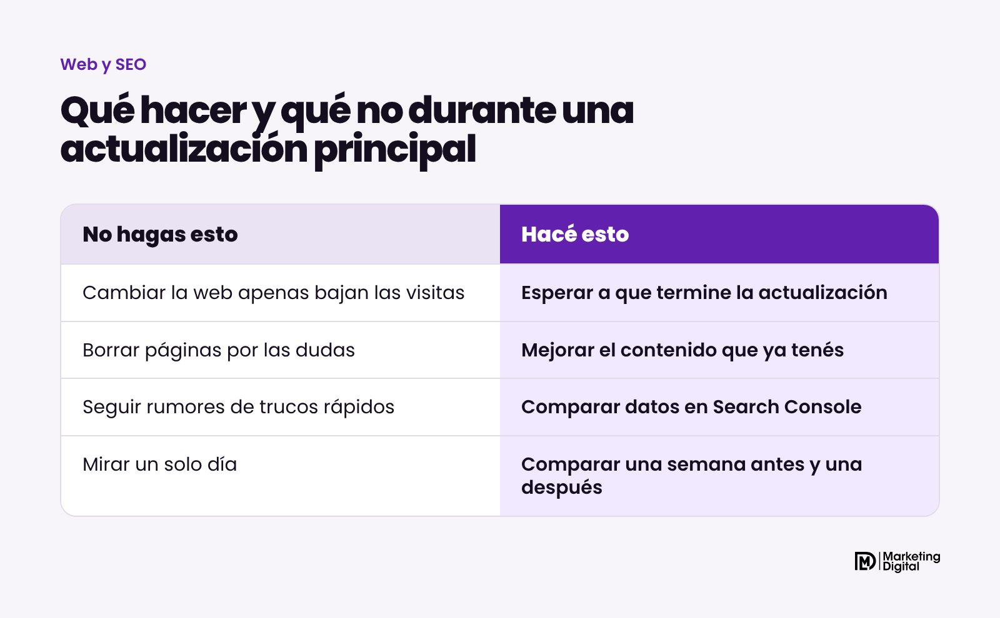
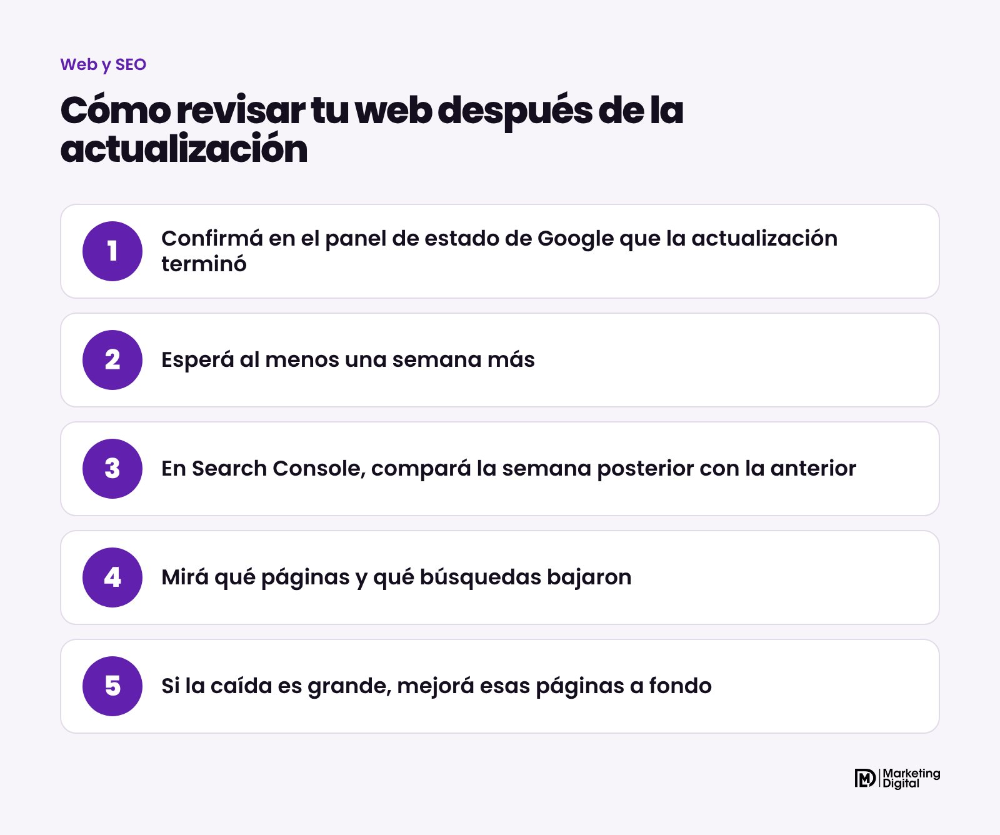

Sí, Google está cambiando cómo ordena sus resultados. El 10 de noviembre de 2026 empezó a aplicar la actualización principal de noviembre, que alcanza a todos los países y a todos los idiomas, incluida la Argentina, y que puede tardar hasta dos semanas en completarse. Durante esos días es normal que las visitas de tu web suban o bajen. Lo que Google recomienda es no tocar nada apurado: esperar a que termine, dejar pasar una semana más y recién ahí analizar.

## ¿Qué es una actualización principal?

Google hace varias veces por año lo que llama actualizaciones principales (core updates, en inglés). Son cambios grandes en los sistemas que deciden qué páginas aparecen primero cuando alguien busca algo. Según Google, el objetivo de esta es "mostrar mejor contenido relevante y satisfactorio" de todo tipo de sitios.

Es la tercera actualización principal de 2026, después de las de marzo y mayo. Cada una tardó cerca de doce días en completarse, según el panel de estado de Google.

## ¿Me castigó Google si bajaron mis visitas?

No necesariamente. Google aclara en su documentación que estas actualizaciones no apuntan a sitios ni a páginas puntuales. Lo explica con una idea simple: si una lista de las mejores páginas cambia, las que bajan no son malas por eso. Puede que otras páginas respondan mejor lo que busca la gente.

> Bajar después de una actualización no es un castigo. Es una señal de que otra página responde mejor esa búsqueda.

Para una pyme, eso cambia la pregunta. No es "qué truco uso para volver", sino "mi página es la mejor respuesta para lo que busca mi cliente".

## ¿Qué hacer mientras dura?

Nada drástico. Google recomienda no hacer cambios rápidos basados en rumores, como sacar partes de la página porque alguien dijo que afectan el posicionamiento.

Lo que sí podés hacer es anotar las fechas. La actualización empezó el 10 de noviembre y, si tarda lo previsto, debería terminar alrededor del 24. Con esas fechas vas a poder comparar bien después.

Hay un detalle para los comercios: la actualización coincide con las semanas previas a las fiestas. Si vendés por tu web, no conviene depender solo de Google en este momento. Los anuncios en Google y en redes, y las campañas que llevan a WhatsApp, te dan un flujo de consultas que no se mueve con cada actualización.

## ¿Cómo revisar tu web cuando termine?

Google propone un método concreto:

1. **Confirmá que terminó.** El panel de estado de la Búsqueda de Google (status.search.google.com) marca cuándo se completa.
2. **Esperá al menos una semana más.** Google recomienda dejar pasar una semana completa antes de analizar.
3. **Compará en Search Console.** En el informe de rendimiento, poné la semana posterior a la actualización contra la semana anterior a que empezara.
4. **Mirá qué bajó.** Las páginas y las búsquedas que más cambiaron. Revisá también por separado la búsqueda web, imágenes y videos.
5. **Decidí según el tamaño.** Si la caída es chica, Google dice que no hace falta tomar medidas drásticas. Si es grande y se sostiene, toca revisar esas páginas a fondo.

## ¿Qué mejorar si la caída es grande?

Google sugiere mirar el sitio entero con ojos objetivos, idealmente con alguien de afuera que no tenga relación con el negocio. Estas son las mejoras que más rinden en una web de pyme:

| Qué revisar | Cómo mejorarlo |
| --- | --- |
| Páginas de servicios | Que expliquen qué hacés, para quién, dónde y cómo se contrata |
| Preguntas frecuentes | Responder las dudas reales que te hacen por WhatsApp |
| Contenido viejo | Actualizar precios, fotos y datos, o unir páginas que dicen lo mismo |
| Lectura | Títulos claros, párrafos cortos y que se lea bien en el celular |

Borrar contenido es el último recurso, según Google, y solo cuando no se puede mejorar. Y hay que tener paciencia: los cambios pueden tardar meses en reflejarse, y a veces recién se ven en la siguiente actualización principal.

## En resumen

Google está reordenando sus resultados hasta fines de noviembre. Si tus visitas se mueven, no es momento de tocar la web a ciegas: esperá, medí con Search Console y mejorá lo que de verdad responde a tus clientes. Si querés que revisemos juntos cómo quedó tu web después de la actualización, escribinos.
