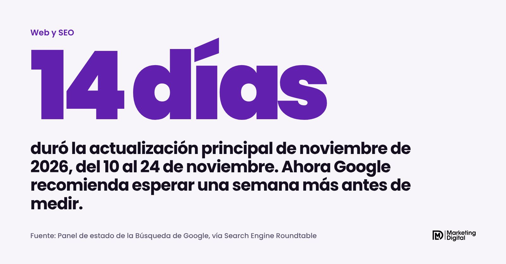
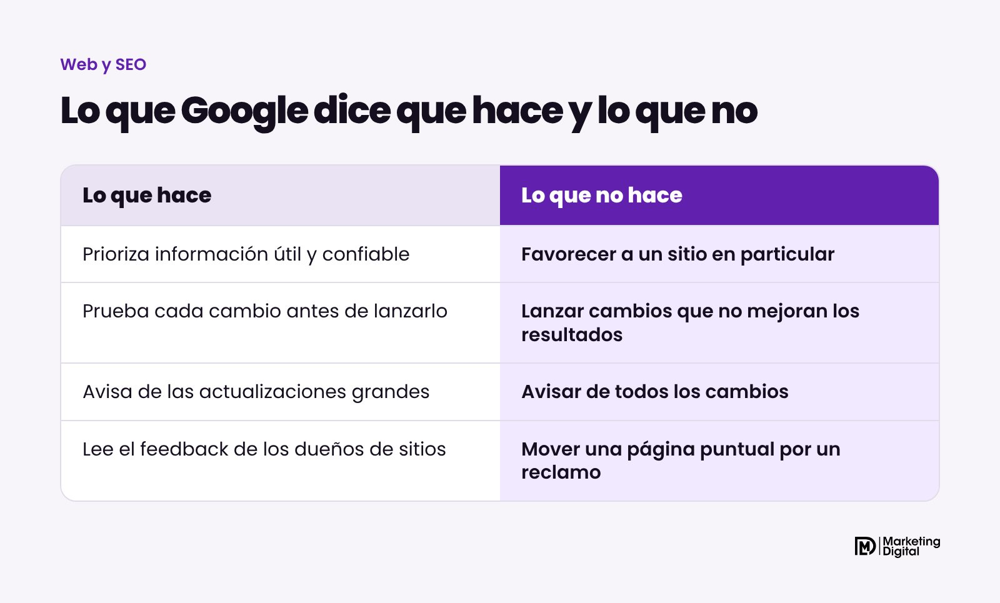
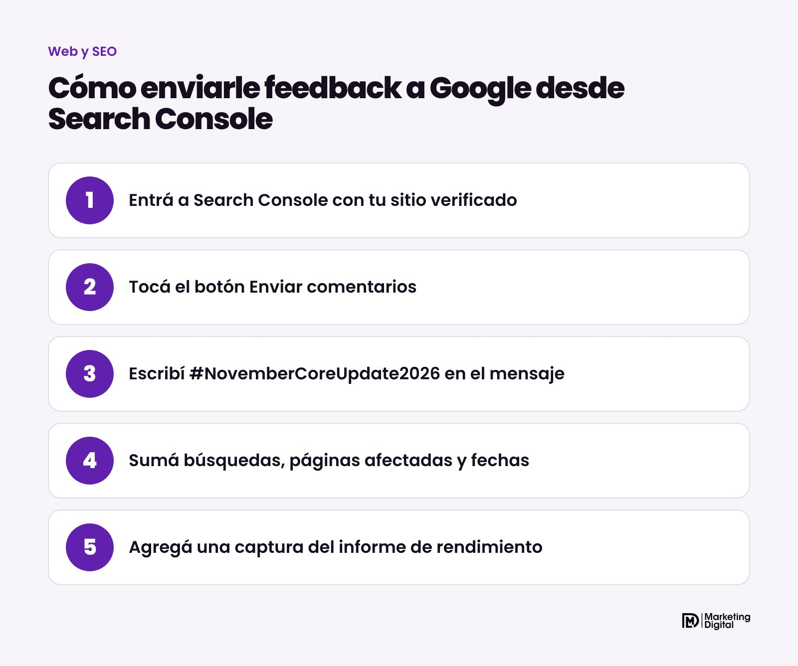

Sí, Google ahora explica por escrito cómo ordena sus resultados y qué podés hacer si tu web cae. El 24 de noviembre de 2026 sumó a su documentación oficial una sección de ranking con tres páginas: sus principios para ordenar resultados, cómo avisa de los cambios y cómo enviar comentarios desde Search Console. El mismo día terminó la actualización principal de noviembre. Para una pyme, la novedad más útil es que existe una vía formal para reportar una caída, aunque Google aclara que no mueve páginas puntuales por un reclamo.

## ¿Qué publicó Google?

Según el registro de cambios de Google Search Central, el objetivo es reunir en un solo lugar cómo Google ordena los resultados, cómo avisa de los cambios de ranking y de políticas, y cómo enviar comentarios. Son tres páginas nuevas:

- **Nuestros principios para ordenar resultados**, que explica qué prioriza Google.
- **Cómo mantenerse informado sobre las actualizaciones**, que dice dónde y cuándo avisa.
- **Enviar comentarios sobre cambios de ranking**, que explica cómo reportar un problema.

La publicación coincidió con el final de la actualización principal de noviembre, de la que hablamos hace dos semanas. Según Search Engine Roundtable, que cita el panel de estado de Google, empezó el 10 de noviembre y terminó el 24, después de 14 días.

## ¿Qué dice Google sobre cómo ordena los resultados?

La página de principios es corta y va al punto. Google dice que prioriza "información útil y confiable, creada para beneficiar a las personas", y que no diseña sus sistemas de ranking ni sus modelos de IA "para favorecer los intereses de ningún sitio en particular". Según el texto, "ningún resultado recibe trato preferencial".

También dice que usa los mismos criterios para todos los formatos: los resultados clásicos, los resúmenes con IA, los carruseles, las imágenes y los videos. Y que prueba cada cambio antes de lanzarlo: si no puede demostrar que mejora las cosas para las personas, no lo lanza. Los únicos ajustes manuales, según Google, son para cumplir obligaciones legales o aplicar sus políticas de contenido.

> Google no promete un lugar en los resultados. Promete que lo decide con las mismas reglas para todos.

Para una pyme, esto confirma algo que ya sabíamos, pero ahora está escrito: no hay atajos ni tratos especiales. La forma de aparecer mejor es tener la página que mejor responde lo que busca el cliente.

## ¿Cómo me entero de los cambios?

Google aclara que no avisa de todo. Avisa cuando un cambio trae requisitos de políticas que hay que cumplir o cuando puede producir movimientos grandes en el ranking, como las actualizaciones principales.

| Dónde avisa Google | Qué publica |
| --- | --- |
| Panel de estado de la Búsqueda | Anuncios previos, inicio y fin de cada actualización |
| Blog de Google Search Central | Las actualizaciones más importantes |
| Registro de cambios de la documentación | Cada página nueva o modificada |

Las tres fuentes se pueden seguir por RSS. Si no querés estar pendiente, alcanza con revisar el panel de estado (status.search.google.com) cuando notes un cambio raro en las visitas.

La misma página repite el consejo que ya dábamos: esperar a que la actualización figure como terminada en el panel, más al menos una semana de datos, antes de evaluar los cambios en Search Console. Con la de noviembre terminada el 24, el análisis conviene hacerlo a partir del 1 de diciembre.

## ¿Cómo le aviso a Google si mi web cayó?

Esta es la parte nueva. Si tu web perdió posiciones con una actualización y creés que los resultados empeoraron, podés mandar comentarios desde Search Console. Según Google:

1. **Tenés que ser dueño verificado del sitio en Search Console.** Si nunca lo configuraste, este es un buen motivo.
2. **Usá el botón para enviar comentarios** dentro de Search Console.
3. **Incluí la etiqueta de la actualización.** Para la de noviembre, Google pide escribir #NovemberCoreUpdate2026.
4. **Sumá datos concretos:** las búsquedas exactas, el país y el idioma, las páginas afectadas y, si querés, las de la competencia que te parece que no deberían estar arriba.
5. **Agregá fechas y números:** cuándo bajó, y las impresiones o la posición antes y después, con una captura del informe de rendimiento.

Lo que tenés que saber antes de hacerlo: según Google, los equipos de ingeniería revisan estos comentarios "en conjunto" para encontrar problemas generales, y enviarlos "no produce ajustes manuales" en URLs individuales. Es decir, sirve para que Google mejore sus sistemas, no para recuperar tu posición. La página tampoco dice si Google responde ni en cuánto tiempo.

## Entonces, ¿qué conviene hacer?

Si tu web bajó en noviembre, el orden sigue siendo el mismo: esperar hasta diciembre, comparar en Search Console la semana posterior contra la anterior a la actualización y revisar qué páginas y qué búsquedas cayeron. Si la caída es grande y ves que tu página responde mejor que las que quedaron arriba, mandá el feedback con datos. Y en paralelo, mejorá las páginas afectadas: es lo único que depende de vos.

Si no tenés Search Console configurado, hacelo ahora. Sin eso no podés ver qué te pasó en Google ni avisarle cuando algo sale mal.

## En resumen

Google puso por escrito que ordena los resultados con las mismas reglas para todos, dónde avisa de los cambios y cómo reportar una caída. El reclamo no te devuelve posiciones, pero el análisis con datos sí te dice qué mejorar. Si querés que revisemos juntos cómo quedó tu web después de la actualización de noviembre, escribinos.
