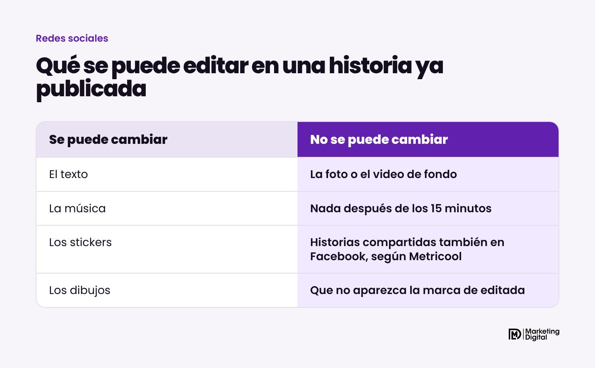
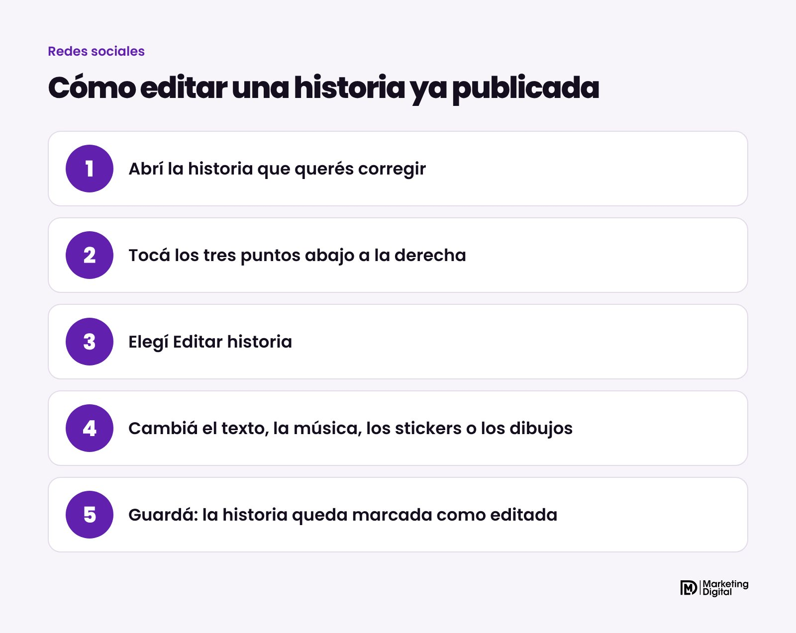

Sí, desde el 18 de noviembre de 2026 Instagram deja editar una historia después de publicarla. Tenés 15 minutos para cambiar el texto, la música, los stickers y los dibujos, y la historia conserva las vistas, los me gusta y las respuestas que ya tenía. La foto o el video de fondo no se pueden reemplazar. Para un negocio que publica promociones, horarios y precios en historias, es la forma de corregir un error sin borrar y volver a empezar.

## ¿Qué anunció Instagram?

Lo anunció Adam Mosseri, el jefe de Instagram, en una publicación en su cuenta. Según Gizmodo, la frase fue que ahora se puede "editar texto, música, stickers y dibujos hasta 15 minutos después de compartir", sin perder vistas, me gusta ni respuestas. La cuenta oficial de Instagram lo acompañó en Threads con un "Lo pidieron, lo hicimos".

Hasta ahora, si una historia tenía un error, la única salida era borrarla y subirla de nuevo. Eso significaba perder todo lo que ya había conseguido: las personas que la habían visto, las reacciones y los mensajes.

La función empezó a llegar el 18 de noviembre y, según Metricool, puede tardar unos días en aparecer en todas las cuentas. Si todavía no la ves, no es un problema de tu teléfono.

## ¿Qué se puede editar y qué no?

Se puede cambiar todo lo que va encima de la foto o el video: el texto, la música, los stickers y los dibujos. Lo que no se puede tocar es la imagen o el video de fondo. Si te equivocaste de foto, hay que borrar y volver a publicar.

Hay dos detalles más. La historia editada muestra la etiqueta "Editada" arriba a la derecha, así que tus seguidores van a saber que hubo un cambio. Y según Metricool, Instagram aclara que no se pueden editar las historias que también se compartieron en Facebook ni las que tienen ciertos stickers, que no detalló.

## ¿Para qué le sirve a un negocio?

Las historias son el lugar donde muchas pymes publican lo del día: la promo, el horario especial, el producto que entró, el link para comprar. Y es justo el tipo de contenido donde un error cuesta caro.

| Error común | Qué podés hacer ahora |
| --- | --- |
| Precio o porcentaje de descuento equivocado | Corregir el texto antes de que lo vea mucha gente |
| Horario o fecha mal puesta | Cambiarlo sin perder las vistas que ya tenía |
| Link que no funciona o lleva a otro lado | Cambiar el sticker de enlace, si esa historia lo permite |
| Sticker de encuesta o pregunta que quedó mal | Reemplazarlo por otro |
| Música que tapa la voz | Cambiar la canción o sacarla |

> Antes, corregir una historia era empezar de cero. Ahora el error se arregla y las vistas se quedan.

El punto clave son los 15 minutos. No es una herramienta para actualizar una historia durante el día, sino para corregir apenas la publicaste. Por eso conviene un hábito simple: publicar, mirar la historia como la vería un cliente y corregir enseguida si algo está mal.

## ¿Cómo se edita una historia?

1. **Abrí la historia** que querés corregir, desde tu perfil.
2. **Tocá los tres puntos** que aparecen abajo a la derecha.
3. **Elegí "Editar historia".** Si no aparece, puede que la función todavía no haya llegado a tu cuenta o que ya hayan pasado los 15 minutos.
4. **Hacé el cambio** en el texto, la música, los stickers o los dibujos.
5. **Guardá.** La historia sigue en el mismo lugar, con la marca de editada.

Si tu cuenta comparte las historias de Instagram en Facebook en forma automática, revisá esa opción: según Metricool, esas historias quedan afuera de la edición.

## ¿Qué más cambió en las historias?

Junto con la edición, según Gizmodo, Instagram sumó tres cosas:

- **Un diseño nuevo para varias fotos**, que permite elegir varias imágenes para una misma historia.
- **Fondos nuevos** para las fotos que no tienen el formato vertical de las historias.
- **Stickers con diseños nuevos**, con otras tipografías, colores y formas.

El diseño de varias fotos le sirve a cualquier comercio: un antes y después, tres productos de una misma línea o los trabajos de la semana en una sola historia.

Y el 17 de noviembre, según TechCrunch, Instagram presentó una herramienta de protección de contenido para creadores que avisa cuando otra cuenta publica un reel tuyo sin permiso, y permite bloquearlo o agregarle una etiqueta que lleva al original. Por ahora llega a creadores que Instagram considera elegibles, que reciben el aviso en su actividad. Si tu negocio hace reels propios y ves que aparece la invitación, conviene activarla.

## En resumen

Instagram por fin deja corregir una historia sin borrarla, durante 15 minutos y sin perder lo que ya había sumado. Para un negocio, eso significa menos promociones con el precio mal y menos links rotos. El hábito que más rinde sigue siendo el mismo: revisar la historia apenas la publicás. Si querés que armemos juntos un plan de historias y reels para tu negocio, escribinos.
