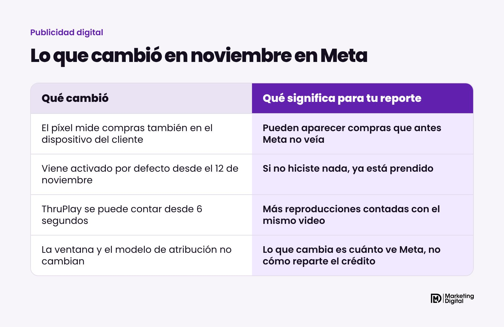
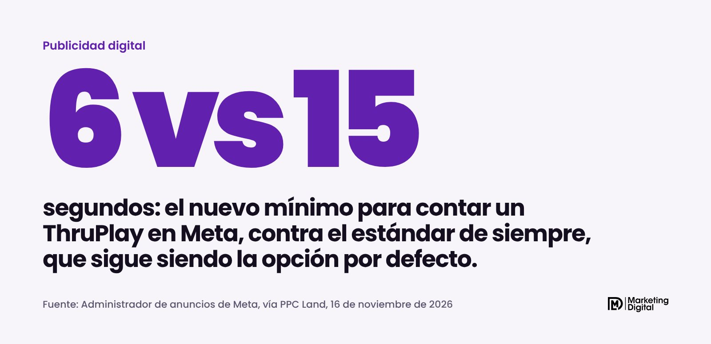
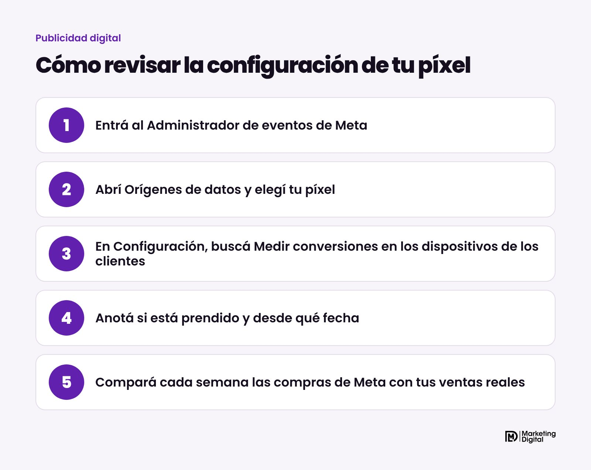

Sí, en noviembre Meta cambió dos cosas en la forma de contar los resultados de tus anuncios. Desde el 12 de noviembre de 2026, el píxel tiene activada por defecto una función que mide algunas compras en el celular o la computadora del cliente, además de en los servidores de Meta. Y en el Administrador de anuncios apareció la opción de contar un ThruPlay desde los 6 segundos de video, en lugar de 15. Las dos pueden hacer que tus reportes muestren más resultados aunque tus ventas sean las mismas. Por eso, justo antes de fin de año, conviene revisar la configuración y medir contra tus ventas reales.

## ¿Qué cambió en el píxel de Meta?

El píxel es el código que Meta pone en tu web para saber qué hace la gente después de ver un anuncio: si entró, si agregó algo al carrito, si compró. Una parte de esas compras nunca le llega a Meta, por bloqueos del navegador, por privacidad o porque la persona cambió de dispositivo.

La nueva función se llama "Medir conversiones en los dispositivos de los clientes". Según el texto que muestra Meta en el panel del píxel, con la función activada "la medición ocurre en el dispositivo de tu cliente en lugar de exclusivamente en los servidores de Meta". Según la ayuda de Meta que citan MetricMaven y Clakta, la coincidencia se hace con datos que el cliente ya le dio al negocio, como el mail, más datos temporales del dispositivo que no lo identifican. Meta recibe solo la confirmación de que hubo una compra y qué campaña se lleva el crédito.

Tres datos importantes:

- **Viene prendida por defecto** en los píxeles que ya envían eventos. Si no tocaste nada, está activada.
- **No se aplica en la Unión Europea ni en el Reino Unido**, así que en Argentina sí corre.
- **La ventana y el modelo de atribución no cambian**, según Meta. Lo que cambia es cuántas compras puede ver, no cómo reparte el crédito entre anuncios.

## ¿Le pasa a cualquier web?

No. Según la ayuda de Meta citada por MetricMaven y Clakta, la función solo trabaja si se cumplen dos condiciones técnicas:

| Condición | Qué significa en la práctica |
| --- | --- |
| El píxel está instalado directo en la página | No sirve si está dentro de un iframe o como píxel de imagen |
| La web pide iniciar sesión con mail o celular | Las tiendas donde se compra sin cuenta pueden quedar afuera |

Muchas tiendas de pymes dejan comprar sin crear una cuenta. En esos casos, Meta no aclaró qué pasa, y el efecto puede ser chico o nulo. Si tu web pide registrarse para comprar, es más probable que notes el cambio.

## ¿Qué cambió con los videos?

ThruPlay es la forma en que Meta cuenta que alguien miró tu video: hasta ahora, 15 segundos o el video completo si dura menos. Según una captura del Administrador de anuncios que publicó PPC Land el 16 de noviembre, las campañas de reconocimiento e interacción que optimizan por ThruPlay ahora tienen un campo nuevo para elegir el mínimo: 6 o 15 segundos. Meta lo presenta como ideal para videos cortos, como reels e historias.

El detalle es matemático. Toda persona que mira 15 segundos ya pasó los 6. Entonces, con la opción de 6 segundos, el número de ThruPlays siempre va a ser igual o mayor, y el costo por ThruPlay igual o menor. No es que el video funcione mejor: es que la vara está más baja. Comparar una campaña de 6 segundos con una de 15 es comparar dos cosas distintas.

> Si el reporte cambia la forma de contar, el número sube aunque el negocio venda lo mismo.

## ¿Es bueno o malo para tu negocio?

Ninguna de las dos cosas, por sí sola. Que Meta vea compras que antes se le escapaban puede ayudar a que el sistema entienda mejor qué anuncios funcionan. Y un video de 6 segundos bien hecho puede ser justo lo que necesita una marca para que la recuerden.

El riesgo está en leer mal los números. Si en noviembre ves más compras en Meta y pensás que la campaña mejoró, podés subir el presupuesto de algo que en realidad rinde igual que antes. Y eso pasa en el peor momento, cuando se arman las campañas de fin de año. Meta tampoco informó si estas compras nuevas se usan para optimizar las campañas o solo aparecen en los reportes.

## ¿Qué conviene hacer ahora?

1. **Revisá el píxel.** En el Administrador de eventos, entrá a Orígenes de datos, elegí tu píxel y abrí la configuración. Ahí está el interruptor de la nueva función. Anotá si está prendido.
2. **Marcá la fecha.** Escribí en tu planilla de resultados que desde el 12 de noviembre Meta mide distinto. Así, cuando compares diciembre con octubre, sabés que no es la misma regla.
3. **Compará con tus ventas reales.** Cada semana, poné lado a lado las compras que muestra Meta y los pedidos que entraron de verdad, en tu tienda, tu sistema o tu WhatsApp. Si la proporción cambia de golpe, es la medición, no el negocio.
4. **Elegí bien la duración del video.** Si tu campaña busca que la gente vea un mensaje completo, dejá 15 segundos. Si usás videos cortos para que te conozcan, probá con 6, pero no lo compares con campañas viejas.
5. **No cambies todo junto.** Si tocás el píxel, el presupuesto y los anuncios la misma semana, después no vas a saber qué funcionó.

Si vendés por WhatsApp, esta parte te afecta menos: lo que cuenta es la conversación y cuántas terminan en venta. Ese número lo tenés vos, no Meta.

## En resumen

Desde noviembre Meta mide más compras y puede contar más reproducciones de video. Eso puede hacer que tus reportes se vean mejor sin que vendas más. Revisá la configuración del píxel, anotá la fecha del cambio y medí siempre contra tus ventas reales. Si querés que revisemos juntos tus campañas de fin de año y cómo se están midiendo, escribinos.
