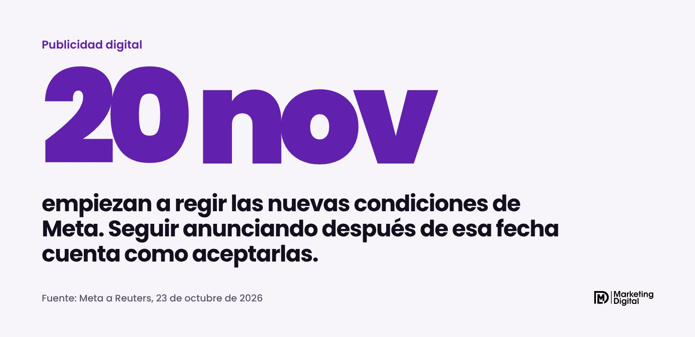
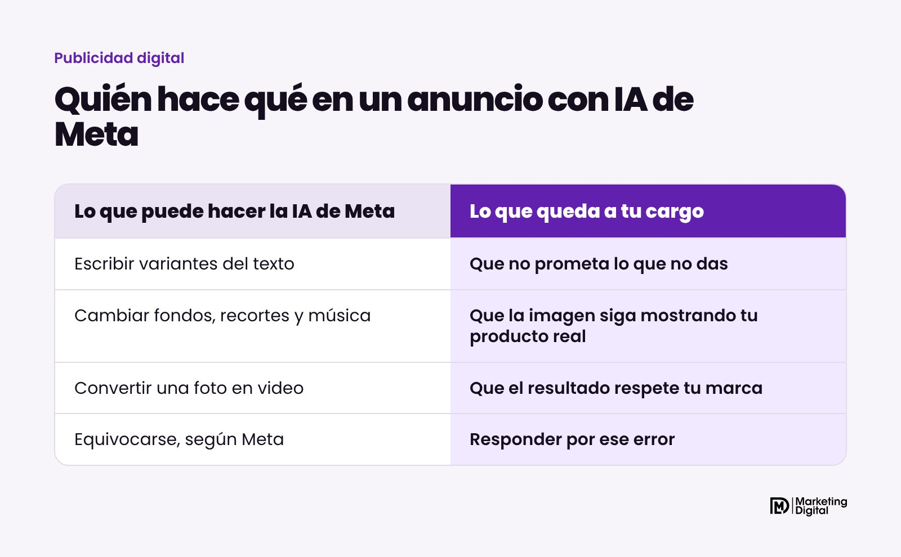
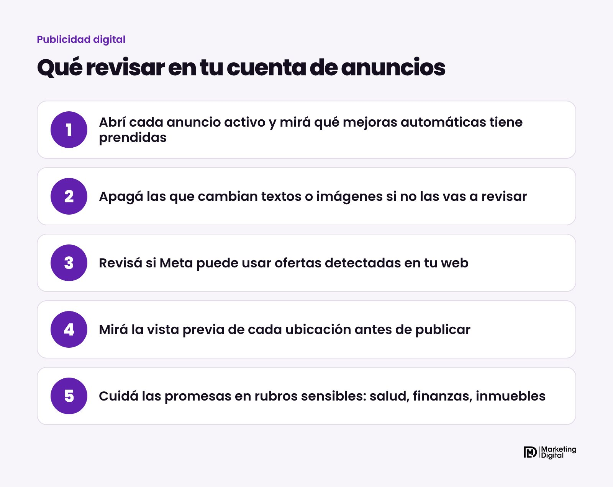

*Actualización del 9 de noviembre de 2026: la primera versión de esta nota decía que las nuevas condiciones de Meta regían desde el 20 de noviembre. Meta las pausó el 5 de noviembre, así que corregimos la nota.*

No, las nuevas condiciones de anuncios de Meta no van a empezar a regir el 20 de noviembre. Meta las pausó y aclaró que siguen vigentes las condiciones actuales. La propuesta hacía al anunciante único responsable de lo que crean o editan las herramientas de inteligencia artificial de Meta en sus anuncios. Aunque esté en pausa, el riesgo de fondo ya existe hoy, y conviene revisar qué tiene activado tu cuenta.

## ¿Qué pasó con las nuevas condiciones?

Meta había anunciado cambios en sus Condiciones comerciales y en las Condiciones de autoservicio de anuncios, las que aceptás al usar el Administrador de anuncios. Primero iban a regir el 30 de octubre y después se pasaron al 20 de noviembre.

Medios y editoriales se quejaron ante autoridades de competencia de Europa y del Reino Unido, sobre todo por una cláusula que permitía a Meta recorrer las webs de los negocios que usan sus productos. El 28 de octubre Meta le dijo a Reuters que podía demorar los cambios. El 5 de noviembre los pausó.

Según Nieman Lab, el centro de ayuda para empresas de Meta ahora dice que las actualizaciones "están en pausa y no entrarán en vigencia el 20 de noviembre de 2026", y que las condiciones existentes siguen vigentes. Un vocero agregó que se toman el tiempo para hacerlo bien.

## ¿Qué decía la propuesta sobre la IA?

Según los textos que citó PPC Land antes de la pausa, había tres puntos que a cualquier anunciante le conviene conocer, porque muestran cómo piensa Meta estas herramientas:

- **La IA se puede equivocar.** Las condiciones decían que las funciones de IA de Meta "pueden cometer errores".
- **La responsabilidad es del anunciante.** El negocio quedaba como único responsable de los riesgos y del contenido que resultara de usar esas funciones.
- **Meta puede cambiar sus productos sin aviso.** Se reservaba el derecho de modificar o discontinuar funciones sin avisar antes.

Que la propuesta esté en pausa no significa que Meta haya cambiado de idea sobre esos puntos. Puede volver con otra redacción.

## ¿Por qué revisar la cuenta igual?

Porque los errores ya están pasando. El 8 de noviembre Social Media Today contó que las herramientas de IA de Meta tomaron descuentos de la web de una tienda y los mostraron en sus anuncios de Facebook e Instagram, incluso cuando el negocio había apagado las promociones en el anuncio original.

Las mejoras automáticas de Advantage+ pueden reescribir tus textos, cambiar el fondo o el recorte de una imagen, sumar música o convertir una foto en un video corto. Muchas vienen prendidas por defecto. Pueden ayudar a que un anuncio rinda más, pero si nadie mira lo que generan, una variante puede prometer un descuento que no existe o un plazo que no cumplís.

> Con o sin condiciones nuevas, si un anuncio promete algo que tu negocio no da, el reclamo te llega a vos.

El riesgo es mayor en algunos rubros:

| Rubro | Qué vigilar en lo que genera la IA |
| --- | --- |
| Salud y estética | Promesas de resultados o de curas |
| Finanzas y seguros | Tasas, cuotas o condiciones que no ofrecés |
| Inmobiliarias y construcción | Precios, metros o plazos inventados |
| Comercios con stock | Productos, descuentos o modelos que no corresponden |

## ¿Qué revisar en tu cuenta?

1. **Revisá tus anuncios activos.** En cada uno, buscá la sección de mejoras de contenido creativo y mirá cuáles están prendidas.
2. **Apagá las que no vas a controlar.** Si no tenés tiempo de revisar las variantes de texto o imagen, es más seguro desactivarlas.
3. **Revisá las ofertas detectadas.** Si vendés online, mirá en el Administrador de ventas si Meta puede usar ofertas que detecta en tu web en otras campañas.
4. **Mirá la vista previa en cada ubicación.** Feed, historias y reels pueden mostrar versiones distintas de un mismo anuncio.
5. **Si tu rubro es sensible, consultalo con tu abogado.** Esta nota explica el tema, no reemplaza una opinión legal.

## En resumen

Las nuevas condiciones de Meta están en pausa y, por ahora, no cambia nada en lo legal. Lo que sí sigue igual es que la IA de Meta puede modificar tus anuncios, y que ya mostró descuentos que nadie había aprobado. Si querés que revisemos juntos qué tienen activado tus campañas, escribinos.
