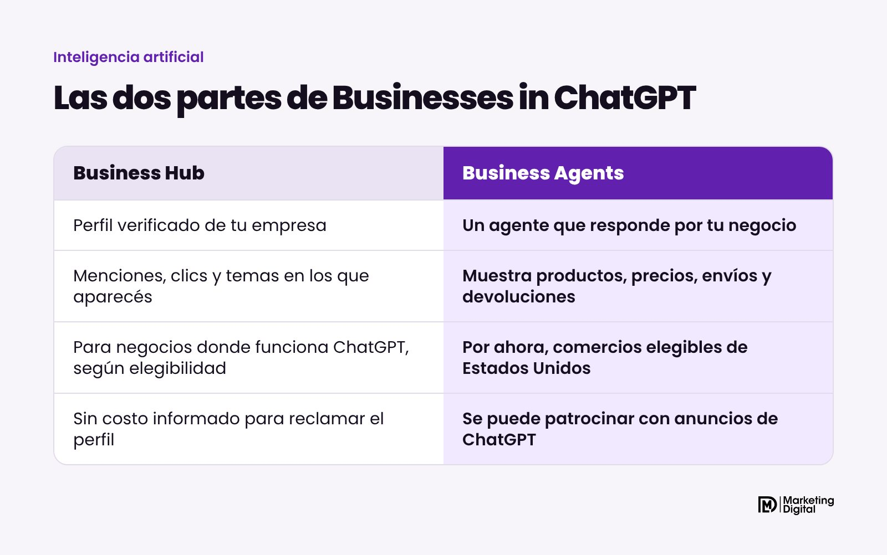
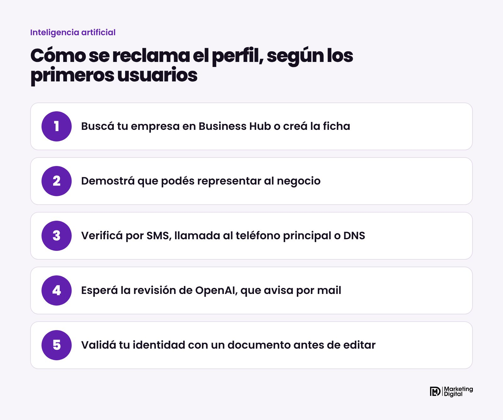
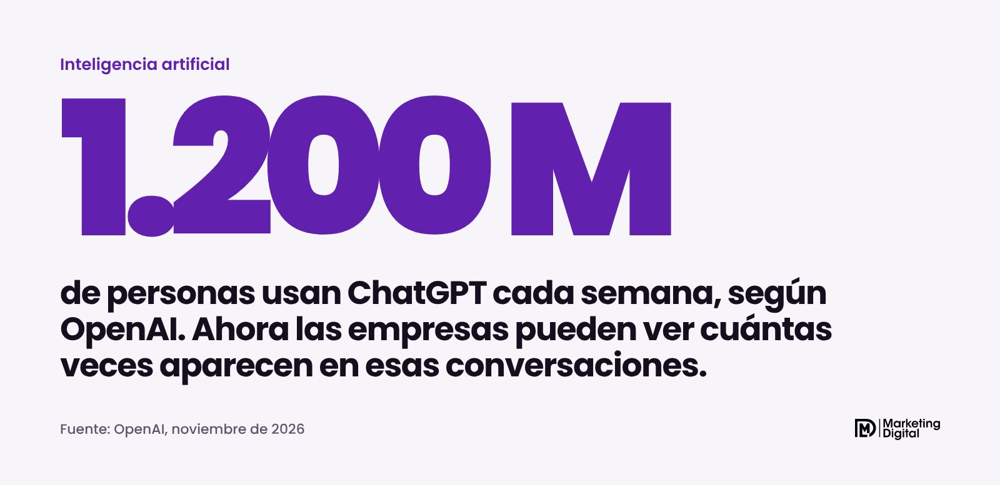

ChatGPT ahora tiene algo parecido al perfil de empresa de Google. El 10 de noviembre de 2026 OpenAI lanzó en beta Businesses in ChatGPT, un programa con dos partes: Business Hub, donde una empresa reclama y verifica su perfil y ve cuántas veces ChatGPT la menciona, y Business Agents, un agente que responde preguntas en nombre del negocio. El perfil está pensado para los mercados donde funciona ChatGPT; los agentes, por ahora, solo para algunos comercios de Estados Unidos. Para una pyme argentina es la primera forma concreta de saber si aparece en las respuestas de la IA.

## ¿Qué lanzó OpenAI?

OpenAI lo presentó como "un primer paso para traer a las empresas más adentro de ChatGPT". Según TechCrunch y PPC Land, el programa tiene dos piezas.

**Business Hub** es un panel para empresas. Ahí reclamás el perfil de tu negocio, lo verificás y actualizás la información sobre tus productos y servicios. Los perfiles administrados por la propia empresa muestran una tilde azul.

**Business Agents** son agentes que responden en nombre de la empresa, con la información de productos y políticas que el negocio carga y las reglas que define. En el perfil, el usuario ve una descripción, tarjetas de productos con precio, condiciones de envío y devolución, y botones para chatear o ir a la web.

## ¿Qué métricas muestra?

Esta es la parte más nueva. Hasta ahora no había forma de saber si ChatGPT recomendaba a tu empresa. Business Hub muestra, según los primeros paneles que relevó PPC Land:

- **Menciones:** cuántas veces aparece tu negocio en las respuestas.
- **Clics hacia tu web**, con la aclaración de que un clic no confirma una visita ni una venta.
- **Los temas** en los que aparecés, los cinco principales.
- **Evolución en el tiempo**, con vistas de 7 y 28 días.

OpenAI no comparte las conversaciones ni las preguntas exactas de los usuarios, y las métricas aparecen solo cuando hay un volumen mínimo, que no informó.

> Por primera vez se puede medir si la IA te recomienda, en lugar de suponerlo.

## ¿Puede usarlo una empresa argentina?

En parte. Según PPC Land e iTechPost, reclamar el perfil está abierto a negocios elegibles en los mercados donde está disponible ChatGPT, y la elegibilidad depende del rubro, la ubicación y los controles de OpenAI. Argentina no aparece mencionada en forma explícita, y PPC Land relevó al menos un caso fuera de Estados Unidos que quedó en lista de espera.

Los agentes para empresas son más limitados: por ahora solo para comercios electrónicos y servicios online elegibles de Estados Unidos. OpenAI dijo que planea sumar mercados y rubros, sin fechas.

Sobre el costo, los artículos coinciden en que OpenAI no informa un cargo para reclamar el perfil. Lo que sí es pago es patrocinar un agente, que funciona como destino de los anuncios de ChatGPT, ya disponibles en Argentina desde octubre.

## ¿Cómo se reclama el perfil?

Según el relevamiento de PPC Land, el proceso tiene cinco pasos:

1. Buscás tu empresa en Business Hub y elegís la ficha existente o creás una nueva.
2. Demostrás que podés representar al negocio.
3. Verificás con un mensaje o una llamada al teléfono principal de la empresa, o por DNS, que es un registro técnico en el dominio de tu web.
4. Esperás la revisión de OpenAI, que avisa el resultado por mail.
5. Validás tu identidad con un documento antes de editar los datos o publicar un agente.

Un consejo práctico: que el teléfono principal que figura en tu web y en tu perfil de Google sea uno que atienda alguien de la empresa. Es una de las formas de verificar.

## ¿Qué conviene hacer ahora?

Aunque el perfil todavía no esté habilitado para tu negocio, hay trabajo que ya suma, porque ChatGPT arma sus respuestas con lo que encuentra en la web:

| Qué revisar | Por qué importa |
| --- | --- |
| Datos de contacto iguales en todos lados | Facilita la verificación y que la IA no se confunda |
| Página de cada servicio o producto | ChatGPT necesita entender qué hacés y dónde |
| Preguntas frecuentes respondidas en tu web | Son las mismas que la gente le hace a ChatGPT |
| Reseñas y menciones en otros sitios | La IA cita fuentes además de tu propia web |

Con 1.200 millones de usuarios semanales, según OpenAI, ChatGPT ya es un lugar donde la gente pregunta a quién comprarle. Que ahora exista un perfil para empresas confirma algo que veníamos diciendo: aparecer en las respuestas de la IA se trabaja igual que aparecer en Google.

## En resumen

OpenAI abrió la puerta para que las empresas tengan presencia oficial en ChatGPT y midan cuánto aparecen. Para una pyme argentina, lo inmediato es preparar la web y los datos para cuando el perfil esté disponible. En MDL somos partner oficial de OpenAI para campañas en ChatGPT; si querés saber cómo aparece hoy tu negocio en las respuestas de la IA, escribinos y lo revisamos.
