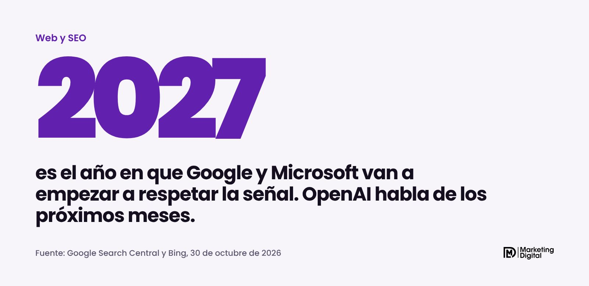
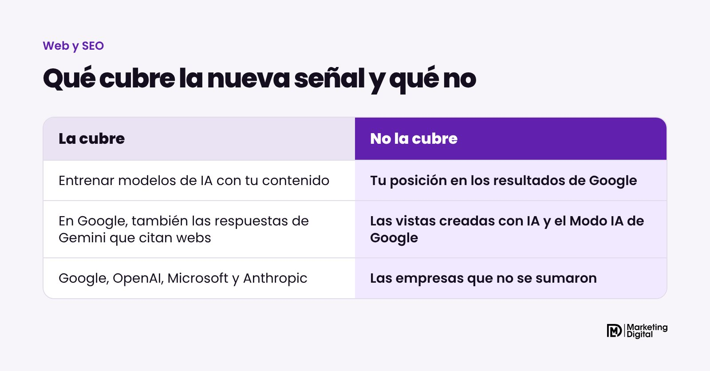
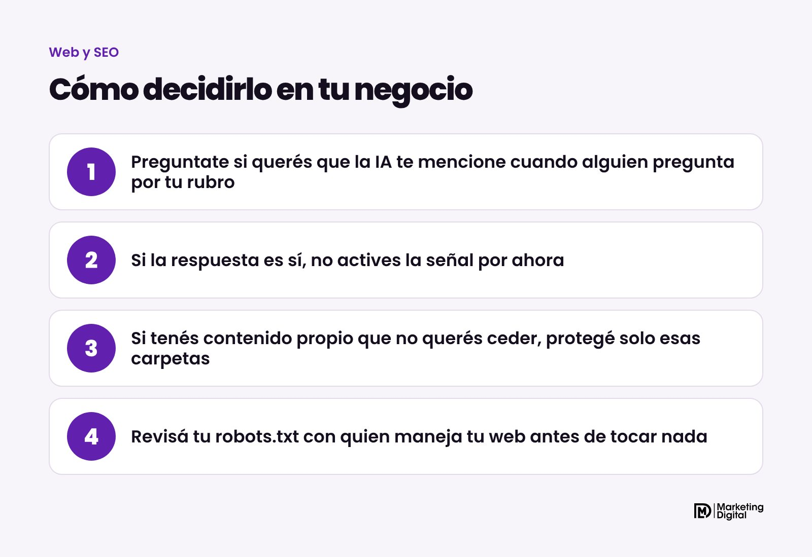

El 30 de octubre de 2026 Google, OpenAI y Microsoft anunciaron que van a respetar una misma señal para que cualquier web pueda decir "no quiero que entrenen inteligencia artificial con mi contenido". Se escribe una sola vez en el archivo robots.txt y vale para todas. No cambia tu posición en los resultados de Google. Pero en el caso de Google tiene un efecto que conviene conocer antes de activarla: también te puede sacar de las respuestas de Gemini.

## ¿Qué se anunció?

Hasta ahora, si no querías que una empresa de IA usara tu web para entrenar sus modelos, tenías que bloquear a cada una por su nombre: Google-Extended para Google, GPTBot para OpenAI, y así con cada empresa. Era fácil olvidarse de alguna.

La propuesta nueva sale de un grupo de trabajo de la IETF, el organismo que define muchos estándares de internet. El borrador lo presentó Kevin Kelley, de Anthropic, y el mismo día Google, OpenAI y Microsoft publicaron que lo van a adoptar. Anthropic también dijo que empezó a implementarlo.

La idea es simple: una sola instrucción en el robots.txt que todas entienden. Se ve así:

    User-Agent: __usage_ai-training
    Disallow: /

La primera línea no nombra a un robot, nombra un uso: el entrenamiento de IA. La segunda dice que no lo aceptás en ninguna página. Si querés dejar alguna carpeta disponible, se agrega una línea de Allow con esa carpeta.

## ¿Cuándo empieza a funcionar?

Todavía no. Google dice en su documentación que planea soportarla a comienzos de 2027. Microsoft la va a respetar desde el 1 de febrero de 2027. OpenAI habló de "los próximos meses", sin fecha. Y el borrador de la IETF todavía no es un estándar aprobado.

Es decir, tenés tiempo para decidir con calma.

## ¿Me baja en Google si la uso?

No. La señal habla del entrenamiento de modelos, no de la búsqueda. Tu posición en los resultados de Google y de Bing no cambia. Las vistas creadas con IA y el Modo IA de Google tampoco se rigen por esta señal: dependen de las reglas de siempre para Googlebot.

El detalle está en otro lado. Google aclaró que si una web usa la señal para no permitir el entrenamiento y no dice nada específico sobre Google-Extended, lo va a tomar como si hubiera bloqueado Google-Extended. Y Google-Extended no solo controla el entrenamiento: también decide si tu web puede aparecer citada en las respuestas de Gemini. En palabras de John Mueller, de Google, las webs que permiten Google-Extended son las que pueden aparecer en esas respuestas y recibir clics desde ahí.

> Bloquear el entrenamiento de IA en Google, hoy, también es bloquear que Gemini te recomiende.

Microsoft lo separó distinto: el entrenamiento por un lado y las respuestas de su IA por otro, con una preferencia aparte.

## ¿Qué le conviene a una pyme?

Depende de qué vendés, pero para la mayoría la respuesta es no activarla. Una pyme de servicios, un comercio o una industria quiere lo contrario: que cuando alguien le pregunte a una IA "¿quién hace mantenimiento de calderas en Escobar?", la respuesta te nombre a vos. Para eso las IA tienen que conocer tu web.

| Tu caso | Qué hacer |
| --- | --- |
| Querés que la IA te mencione y te recomiende | No actives la señal |
| Vendés contenido propio (cursos, informes, fotos) | Protegé solo esas carpetas |
| Medio o editorial que vive de su contenido | Analizalo con tiempo, caso por caso |

## ¿Qué hacer ahora?

1. **Revisá tu robots.txt.** Está en tudominio.com/robots.txt. Fijate si alguien ya bloqueó a GPTBot, Google-Extended u otros robots de IA sin que lo sepas.
2. **Decidí qué querés.** Si tu objetivo es que te encuentren, no hace falta hacer nada.
3. **Si tenés algo que proteger, hacelo por carpeta.** Bloqueá solo esa parte, no toda la web.
4. **Anotá 2027 en la agenda.** Cuando las empresas empiecen a leer la señal, conviene revisar que todo siga como lo dejaste.

## En resumen

Es una buena noticia para quien quiere cuidar su contenido: por fin hay una sola forma de decirlo. Para una pyme que quiere más clientes, el riesgo es copiar la línea sin entender que en Google también te saca de las respuestas de Gemini. Si querés que revisemos cómo está configurada tu web para aparecer en Google y en las respuestas de la IA, escribinos y lo vemos juntos.
