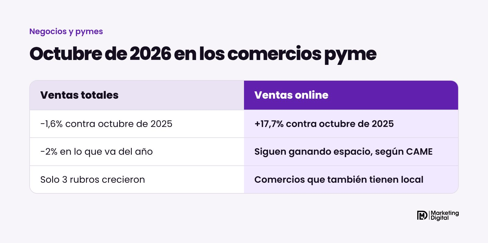
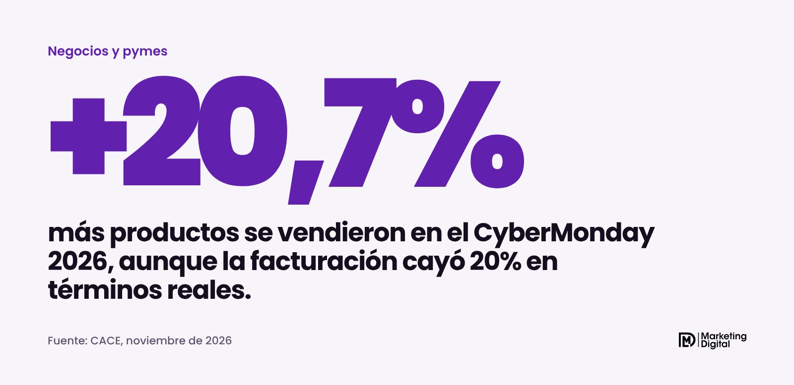
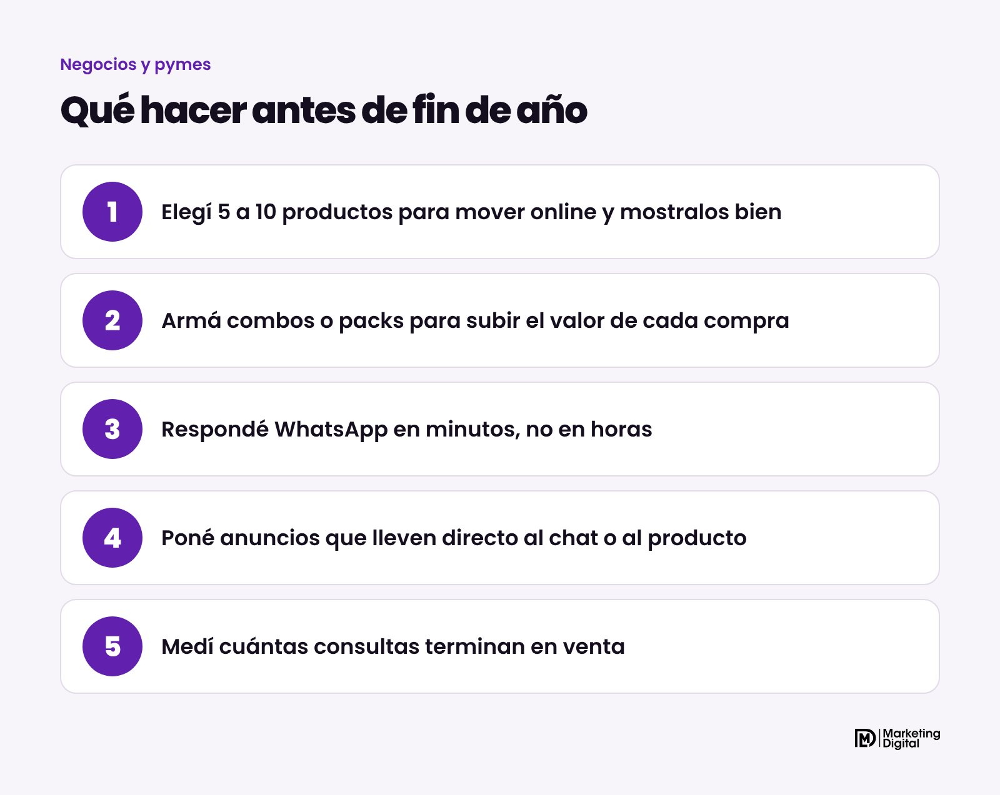

Sí, el consumo sigue flojo, pero no en todos los canales. Según el relevamiento de CAME, en octubre de 2026 las ventas minoristas pyme cayeron 1,6% contra el mismo mes del año pasado. En cambio, las ventas online de los comercios que también tienen local crecieron 17,7%. Para una pyme, el mensaje es claro: los clientes no desaparecieron, cambiaron de lugar. Y a fin de año, la diferencia la va a hacer quien esté bien parado en internet y en WhatsApp.

## ¿Qué dice el informe de CAME?

La Confederación Argentina de la Mediana Empresa publica todos los meses su índice de ventas minoristas pyme. El de octubre de 2026 dejó estos números:

- **Ventas totales:** -1,6% interanual, +0,3% contra septiembre y -2% en los primeros diez meses del año.
- **Rubros que crecieron:** calzado y marroquinería (+3,6%), textil e indumentaria (+3,6%) y perfumería (+0,8%).
- **Rubros que más cayeron:** farmacias (-3,7%), alimentos y bebidas (-3,5%) y ferretería, materiales eléctricos y de construcción (-3,4%).

El dato que más llama la atención es el del canal digital. Según CAME, los canales digitales "continúan ganando espacio dentro de las estrategias comerciales de las pymes". Y el ánimo de los comerciantes acompaña con cautela: el 41,1% espera que su situación mejore en los próximos doce meses, aunque el 54,9% cree que hoy no hay condiciones para invertir.

## ¿Qué mostró el CyberMonday?

El CyberMonday se hizo del 2 al 4 de noviembre, con cerca de 800 empresas, y casi la mitad eran pymes. Los resultados que difundió la Cámara Argentina de Comercio Electrónico (CACE) muestran un consumidor que compra, pero que cuida cada peso:

| Indicador del CyberMonday 2026 | Contra 2025 |
| --- | --- |
| Productos vendidos | +20,7% |
| Órdenes de compra | -7,1% |
| Facturación, en términos reales | -20% |
| Ticket promedio, en términos reales | -14,4% |

Es decir: menos compras, pero con más productos por compra, y gastando menos en total. La gente aprovecha las ofertas para llevar varias cosas juntas y compara mucho antes de decidir.

> El cliente no dejó de comprar. Compra más pensado, compara más y elige al que le resuelve rápido.

## ¿Qué significa para tu pyme?

Tres cosas concretas.

**La primera: tener canal online ya no es opcional.** No hace falta una tienda online gigante. Para muchas pymes alcanza con un catálogo claro, buenas fotos y un WhatsApp que conteste. Lo que importa es que el cliente pueda ver qué vendés y preguntar sin moverse de su casa.

**La segunda: el combo vende.** Si en el CyberMonday cada orden llevó más productos, la gente está dispuesta a sumar si siente que le conviene. Los packs, los combos y el "llevá dos" suben el valor de cada venta sin bajar tanto el precio.

**La tercera: la velocidad de respuesta decide.** Quien compara precios en tres comercios le compra al primero que le contesta bien. En las campañas que manejamos lo vemos todo el tiempo: una consulta que espera horas suele ser una venta perdida.

## ¿Qué hacer antes de fin de año?

1. **Elegí entre 5 y 10 productos para empujar online.** Los que más rotan o los que mejor margen te dejan. Sacales buenas fotos y escribí una descripción con precio, medidas y condiciones.
2. **Armá combos para las fiestas.** Regalos, kits, "todo lo que necesitás para…". Le facilitás la decisión al cliente y subís el valor de cada compra.
3. **Organizá la atención por WhatsApp.** Respuestas rápidas guardadas, horarios claros y alguien a cargo. Si las consultas te desbordan, un agente de IA puede contestar las preguntas frecuentes a cualquier hora.
4. **Poné anuncios que lleven directo a la venta.** En Instagram y Facebook, los anuncios que abren un chat de WhatsApp funcionan bien para comercios que venden con asesoramiento.
5. **Medí cuántas consultas terminan en venta.** Es el número que te dice si el problema está en el anuncio, en el precio o en la atención.

## En resumen

Octubre dejó dos noticias en una: el comercio pyme sigue en baja, y el canal online sigue creciendo. Las pymes que muestren bien sus productos, armen combos y contesten rápido van a llegar mejor a fin de año. Si querés que armemos juntos tus campañas para las fiestas, escribinos por WhatsApp.
